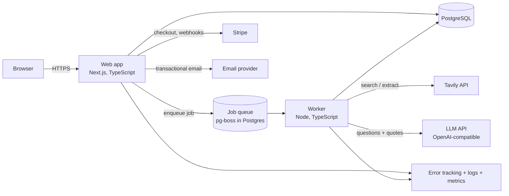

# Architecture

Last updated: 2026-10-28. Proposed; becomes final when the ADRs are accepted.

## 1. Overview

One language (TypeScript) everywhere. One database (Postgres) also holds the job queue,
so there is no Redis to run. The web app never calls Tavily or the LLM directly; only the
worker does. That keeps slow and expensive calls out of web requests.

## 2. Components

| Component | Responsibility |
|---|---|
| **Web app** | Pages, API routes, auth, permissions, validation, billing webhooks |
| **Worker** | Runs research jobs step by step, retries, budget checks, progress updates |
| **Postgres** | All data, the job queue, and the response cache |
| **Shared package** | Types, input schemas, scoring rules, used by web and worker |

## 3. Research pipeline (one run)

Each step is a separate job, so a crash resumes from the last finished step.

1. **Plan**: expand the thesis into search queries; compute the credit ceiling; reserve credits.
2. **Discover**: Tavily Search per query; drop directories and excluded domains; deduplicate by domain.
3. **Merge seeds**: add the buyer's uploaded companies.
4. **Read**: Tavily Extract in batches; store page text per company.
5. **Signals**: founded year, ownership words, parent-company / PE phrases (rules ported from the prototype).
6. **Verify**: the LLM answers each thesis question using only page text. Each yes/no must include
   a quote; the worker checks the quote is really in the page. If not, the answer becomes "unknown".
7. **Score and rank**: weights from the thesis; required questions can fail a company.
8. **Finish**: release unused reserved credits; notify the user.

Website text goes to the LLM as data only. The LLM has no tools and cannot browse, so text on
a website cannot make it take actions (prompt-injection containment).

## 4. Data model (main tables)

| Table | Key fields |
|---|---|
| `users` | id, email, password hash or OAuth id, email_verified_at |
| `workspaces` | id, name, plan, monthly_credit_cap |
| `memberships` | user_id, workspace_id, role |
| `theses` | id, workspace_id, name, definition (validated JSON), version |
| `runs` | id, workspace_id, thesis_id, thesis_snapshot, status, credits_reserved, credits_used, started/finished |
| `run_steps` | run_id, step, status, attempts, error |
| `companies` | id, run_id, domain, name, source (search/seed), score, status |
| `facts` | company_id, kind (founded_year, criterion, parent_flag…), value, quote, source_url |
| `reviews` | company_id, user_id, decision, note |
| `usage_events` | workspace_id, run_id, provider, credits, cost_usd, created_at |
| `api_cache` | request_hash, provider, response, created_at, expires_at |
| `audit_log` | workspace_id, user_id, action, target, ip_hash, created_at |
| `billing` | workspace_id, stripe_customer_id, subscription status |

Every table holding customer data has `workspace_id`. Postgres row-level security is the second
line of defense behind application checks (see SECURITY.md).

## 5. Proposed stack (see ADRs)

| Area | Choice | Why |
|---|---|---|
| Web | Next.js (App Router) + TypeScript | Mature, server rendering, one codebase for UI and API |
| UI | Tailwind CSS + accessible headless components (Radix-based) | Fast, consistent, keyboard and screen-reader support |
| Database | PostgreSQL 16+ | Reliable, row-level security, JSON support |
| ORM / migrations | Drizzle | Typed queries, plain SQL migrations |
| Queue | pg-boss | Jobs in Postgres; retries and scheduling without Redis |
| Auth | Better Auth (or Auth.js; decided in ADR-0003) | Email/password, OAuth, sessions in our DB |
| Validation | Zod | One schema for forms, API and worker |
| Payments | Stripe | Checkout, subscriptions, tax, webhooks |
| Email | Resend or Postmark | Transactional email with domain authentication |
| Errors / tracing | Sentry + OpenTelemetry | Find errors and slow paths |
| Tests | Vitest, Playwright, axe-core | Unit, end-to-end, accessibility |
| Deploy | Docker images; host decided in DECISIONS-NEEDED | Same image runs locally and in production |

Exact versions are pinned in the lockfile when the project is created; this document does not
claim specific version numbers.
