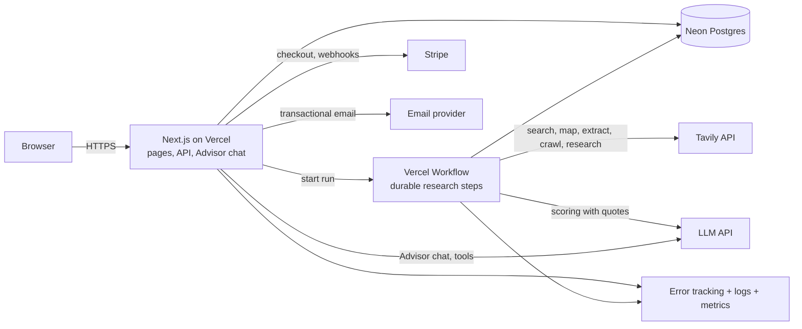

# Architecture

Last updated: 2026-10-28. Proposed; becomes final when the ADRs are accepted.

## 1. Overview

Hosting is Vercel; the database is Neon (ADR-0004). One language (TypeScript) everywhere.
Page requests never call Tavily directly; research runs in durable Workflow steps.
The only Tavily call started from the chat is a deep dive, and it runs as a Workflow too.

## 2. Components

| Component | Responsibility |
|---|---|
| **Web app** | Pages, API routes, auth, permissions, validation, billing webhooks |
| **Research workflow** | Pipeline steps, retries, budget checks, progress updates (Vercel Workflow) |
| **Advisor** | Grounded chat over a run's evidence; typed tools for filter, rank, compare, pin, deep dive (ADR-0005) |
| **Neon Postgres** | All data and the Tavily response cache |
| **`packages/core`** | Pipeline logic, scoring, signals, quote check, Tavily client; plain functions, no Vercel APIs |

## 3. Research pipeline (one run)

Each stage is a Workflow step (large stages are split into batches), so a failure retries only
that piece. Full Tavily details: `TAVILY-STRATEGY.md`.

1. **Plan**: LLM turns the thesis into 10–30 search queries; compute and reserve the credit ceiling.
2. **Discover**: Tavily Search fan-out; drop directories and excluded domains; deduplicate by domain.
3. **Merge seeds**: add the buyer's uploaded companies.
4. **Map**: Tavily Map with instructions finds each candidate's About / History / Team / Services pages.
5. **Read**: Tavily Extract on those pages with query-ranked chunks; retry failures at advanced depth.
6. **Signals**: founded year, ownership words, parent-company / PE phrases (ported from the prototype).
7. **Verify**: the LLM answers each thesis question using only page text. Each yes/no must include
   a quote; code checks the quote is really in the page. If not, the answer becomes "unknown".
8. **Score and rank** all candidates.
9. **Red-flag check** (top ~25): Tavily news Search for acquisitions, lawsuits, ownership changes.
10. **Deep read** (top ~10): Tavily Crawl with instructions; re-verify and re-rank.
11. **Shortlist**: pick the top 10 with a one-line reason and best evidence each.
12. **Finish**: release unused reserved credits; notify the user.

**On demand:** a **deep dive** runs Tavily Research with a fixed output schema and our evidence
attached as files, for companies the buyer chooses.

Website text goes to the LLM as data only. The LLM has no tools and cannot browse, so text on
a website cannot make it take actions (prompt-injection containment).

## 4. Data model (main tables)

| Table | Key fields |
|---|---|
| `users` | id, email, password hash or OAuth id, email_verified_at |
| `workspaces` | id, name, plan, monthly_credit_cap |
| `memberships` | user_id, workspace_id, role |
| `theses` | id, workspace_id, name, definition (validated JSON), version |
| `runs` | id, workspace_id, thesis_id, thesis_snapshot, status, credits_reserved, credits_used, started/finished |
| `run_steps` | run_id, step, status, attempts, error |
| `companies` | id, run_id, domain, name, source (search/seed), score, status |
| `facts` | company_id, kind (founded_year, criterion, parent_flag…), value, quote, source_url |
| `reviews` | company_id, user_id, decision, note |
| `usage_events` | workspace_id, run_id, provider, credits, cost_usd, created_at |
| `shortlist_items` | run_id, company_id, position, reason, pinned, hidden |
| `chat_threads` / `chat_messages` | run_id, user_id, role, content, cited_fact_ids, tool_calls |
| `deep_dives` | company_id, tavily_request_id, status, dossier (JSON), credits_used |
| `api_cache` | request_hash, provider, response, created_at, expires_at |
| `audit_log` | workspace_id, user_id, action, target, ip_hash, created_at |
| `billing` | workspace_id, stripe_customer_id, subscription status |

Every table holding customer data has `workspace_id`. Postgres row-level security is the second
line of defense behind application checks (see SECURITY.md).

## 5. Proposed stack (see ADRs)

| Area | Choice | Why |
|---|---|---|
| Web | Next.js (App Router) + TypeScript | Mature, server rendering, one codebase for UI and API |
| UI | Tailwind CSS + accessible headless components (Radix-based) | Fast, consistent, keyboard and screen-reader support |
| Hosting | Vercel | Owner's choice (ADR-0004) |
| Database | Neon Postgres | Owner's choice; serverless, branch per preview deploy, row-level security |
| ORM / migrations | Drizzle | Typed queries, plain SQL migrations, works with Neon |
| Background runs | Vercel Workflow | Durable, retryable steps on Vercel (ADR-0004) |
| Chat | Vercel AI SDK | Streaming, typed tool calls, many LLM providers |
| Auth | Better Auth (or Auth.js; decided in ADR-0003) | Email/password, OAuth, sessions in our DB |
| Validation | Zod | One schema for forms, API and worker |
| Payments | Stripe | Checkout, subscriptions, tax, webhooks |
| Email | Resend or Postmark | Transactional email with domain authentication |
| Errors / tracing | Sentry + OpenTelemetry | Find errors and slow paths |
| Tests | Vitest, Playwright, axe-core | Unit, end-to-end, accessibility |
| Local dev | Neon dev branch (or local Postgres container) | Same schema as production |

Exact versions are pinned in the lockfile when the project is created; this document does not
claim specific version numbers.
