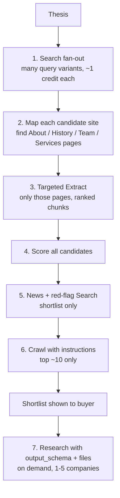

# How Sieveline uses Tavily

Last updated: 2026-10-28. Based on Tavily's docs read on this date (Search, Extract, Map, Crawl,
Research, Credits, Rate limits). Re-check the docs before M3 in case parameters changed.

## Principle: maximum information per credit

"Getting the max out of Tavily" here means using **every endpoint for the job it does best**,
in a funnel: cheap and wide first, expensive and deep only for the few companies that matter.
Spending more credits is not the goal. Getting answers no simple search tool would find is.

## Stage by stage

| # | Endpoint | Used on | Parameters we use, and why | Cost (from docs) |
|---|---|---|---|---|
| 1 | **Search** (discovery) | Whole thesis | LLM writes 10–30 query variants (synonyms, services, customer industries, places). `search_depth` basic for breadth, advanced for niche terms; `max_results` 20; `country` boost; `exclude_domains` (up to 150) for directories, competitors, known owners; `include_domains` + `include_domains_mode: prefer` to favor trade associations when useful; `exact_match` for quoted names; `chunks_per_source` 3 so snippets already help first-pass filtering | 1 credit (basic/fast), 2 (advanced) |
| 2 | **Map** | Every candidate that passes a quick snippet filter | `instructions`: "pages about company history, ownership, leadership, services, locations, accreditations, careers"; `max_depth` 1–2, `limit` ~30. Finds the right pages instead of reading only the homepage | 1 credit / 10 pages; 2 with instructions |
| 3 | **Extract** | 2–5 best pages per candidate from Map | `query` set to the thesis questions so Tavily ranks chunks by relevance; `chunks_per_source` 5; `extract_depth` basic, retry failures with advanced (tables, embedded content). Failed URLs are not charged | 1 credit / 5 URLs (basic), 2 (advanced) |
| 4 | — | All candidates | Signals + LLM scoring with mandatory quotes (ARCHITECTURE §3) | LLM only |
| 5 | **Search** (news, red flags) | Top ~25 | `topic: news` with `time_range: year` for "acquired", "merger", "lawsuit", "retire", "new owner"; `include_domains` = company domain for "site-scoped" checks; `include_published_date` so the buyer sees dates | 1 credit each |
| 6 | **Crawl** | Top ~10 | `instructions` focused on the thesis; `select_paths` like `/about.*`, `/team.*`, `/history.*`; `exclude_paths` for blogs/shop; `max_depth` 2, `limit` 20–40; `chunks_per_source` 5; `allow_external: false` | Map cost + Extract cost |
| 7 | **Research** | 1–5 companies the buyer picks ("Deep dive") | `output_schema` returns a fixed dossier shape (ownership, history, services, customers, risks, sources); `files` = our evidence as JSON/Markdown so Research builds on what we found instead of repeating it (limit 5 files, 80k words total); `include_domains` = company site (soft preference, max 20); `exclude_domains` = directories (max 20); `model` mini for most, pro on request; `stream: true` so progress shows live | 4–110 credits (mini), 15–250 (pro) per request |

Every request sets `include_usage: true` so we bill and cap from Tavily's own numbers, not guesses.

## Implementation status (2026-10-28)

Implemented in `packages/core/src/research/` and `apps/web/src/workflows/research.ts`:
search fan-out with LLM query planning (templates first, operators stripped), Map with
instructions and same-site page picking, Extract with query-ranked chunks and advanced retry only
for failed URLs, news red-flag checks (succession treated as a signal), Crawl deep read for the top
companies, and a per-call budget guard that refuses any call whose worst case exceeds the run's
remaining reservation.

Deep dives (M5-T05) are implemented in `packages/core/src/research/deep-dive.ts` and
`apps/web/src/workflows/deep-dive.ts`. What differs from the plan in the table above, and why:

- **Polling, not streaming.** A durable workflow creates the task once and polls `GET /research/{id}` every 15 s
  (up to 30 min). Sleeping costs nothing and survives redeploys; a held-open stream does not.
- **No `exclude_domains`.** Directories (LinkedIn, ZoomInfo, RocketReach) are noise for finding companies but are
  the main source of leadership and headcount in a dossier, so they are allowed here.
- **One file**: `verified-facts.md` with our quote-checked facts.

Facts measured against the live API on 2026-10-28:

- `files[]` items are `{ name, data }` (base64). The docs' wording ("filename and its base64-encoded contents")
  led to `{ filename, content }`, which returns HTTP 422 `Field required`. A rejected request creates no task.
- `GET /research/{id}` reports credits only with the query parameter `include_usage=true`.
- One real `mini` deep dive (allometrics.com): **84 credits**, about 80 s, 16 sources, all schema fields filled.
  That is near the 110 upper bound and about 10x the whole 8-credit test list. Treat ~85 as typical until more
  samples exist.

## Engineering rules

- **Rate limits** (docs, production key): 1,000 requests/min general, 100/min Crawl,
  20/min Research creation, 10 per 10 min for the usage endpoint. The client keeps a separate
  limiter per endpoint and honors `Retry-After` on 429 responses.
- **Cache** every response by request hash. Re-running or chatting about a list costs 0 credits.
- **Escalate only on need.** Basic depth first; advanced only when basic fails or returns thin text.
- **Reserve, then reconcile.** Reserve the worst-case credits before each stage; release what
  `usage.credits` shows was not spent.
- **Reconcile daily** with Tavily's usage endpoint; alert if our ledger and Tavily's differ by > 5%.
- **Show cost before spending.** Deep dives (Research) always ask the buyer to confirm the credit range.

## What we never send to Tavily

Tavily's terms give them a perpetual license to anything we send. We send only search queries,
company URLs, and evidence collected from public company websites. We never send buyer names,
emails, private notes, chat messages, or uploaded private documents.

## Expected cost per list (estimate, to be measured in M3-T08)

| Stage | Assumption | Credits |
|---|---|---|
| Search fan-out | 25 queries, mostly basic | ~30 |
| Map | 120 candidates × ~3 pages, with instructions | ~72 |
| Extract | 120 × 4 pages, basic | ~96 |
| News checks | 25 × 2 searches | ~50 |
| Crawl | 10 × ~30 pages | ~90 |
| **Total before deep dives** | | **~340 credits ≈ $1.70–2.70** |
| Each deep dive (Research mini) | | 4–110 credits (1 real sample: 84) |

These numbers are planning estimates, not measurements.
