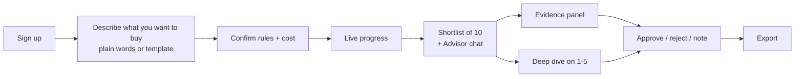

# Design

Last updated: 2026-10-28

## 1. Principles

1. **Proof first.** Every fact is one click from its source quote and link.
2. **Calm, dense, readable.** Users scan hundreds of rows; the table is the product.
3. **No surprises about cost.** Show the credit ceiling before a run and live usage during it.
4. **Keyboard friendly.** Review a list without touching the mouse (j/k to move, a/r to approve/reject).

## 2. Main user flow

The buyer can describe the thesis in plain words ("independent calibration labs in Texas,
15+ years, serving aerospace"); the LLM turns it into editable rules for confirmation.

## 3. Screens

| Screen | Key content |
|---|---|
| Landing page | What it does, a sample result with evidence, pricing, sign-up |
| Sign in / sign up / reset | Short forms, clear errors, password manager friendly |
| Dashboard | Recent runs, credits left this month, "New list" button |
| Thesis builder | Step form: industry & places → rules → questions → exclusions → review cost |
| Run page | Progress by step, companies found/read/checked, credits used, cancel |
| **Shortlist (main screen)** | Left: 10 company cards (name, one-line reason, 2–3 key facts with quote icons, pin/hide). Right: Advisor chat with suggested prompts ("Compare the top 3", "Only family-owned", "Why is #1 first?"). Chat changes update the cards live |
| Full list | Table of all checked companies: status, score, founded, flags, review state; filters; bulk actions |
| Evidence panel | Side drawer: summary, each question with answer + quote + link, signals, news flags, notes |
| Deep dive | Streams progress, then a dossier with sections and numbered sources; cost shown before start |
| Settings | Workspace, members and roles, billing, usage history, data export/delete |
| Admin (operator) | All workspaces, runs, failures, spend |

## 4. Design system

- Tokens for color, spacing, type, radius, shadow; light and dark themes.
- Text contrast ≥ 4.5:1; status never shown by color alone (icon + label).
- Status labels: Strong fit, Possible fit, Weak fit, Verify ownership, Fails a rule, No website text.
- Empty, loading, and error states designed for every screen.
- Responsive: full features from 1280 px; usable read-only review down to 375 px.

## 5. Brand

Name: **Sieveline** (proposed, D1). A sieve keeps only what matters; "line" is the buyer's deal
pipeline. Logo and colors are open (D8); neutral defaults until then.
