# Design

Last updated: 2026-10-28

## 1. Principles

1. **Proof first.** Every fact is one click from its source quote and link.
2. **Calm, dense, readable.** Users scan hundreds of rows; the table is the product.
3. **No surprises about cost.** Show the credit ceiling before a run and live usage during it.
4. **Keyboard friendly.** Review a list without touching the mouse (j/k to move, a/r to approve/reject).

## 2. Main user flow

```mermaid
flowchart LR
  A[Sign up] --> B[Create workspace]
  B --> C[Pick template or new thesis]
  C --> D[Edit rules + questions]
  D --> E[See cost estimate]
  E --> F[Start run]
  F --> G[Live progress]
  G --> H[Results table]
  H --> I[Evidence panel]
  I --> J[Approve / reject / note]
  J --> K[Export CSV or Excel]
```

## 3. Screens

| Screen | Key content |
|---|---|
| Landing page | What it does, a sample result with evidence, pricing, sign-up |
| Sign in / sign up / reset | Short forms, clear errors, password manager friendly |
| Dashboard | Recent runs, credits left this month, "New list" button |
| Thesis builder | Step form: industry & places → rules → questions → exclusions → review cost |
| Run page | Progress by step, companies found/read/checked, credits used, cancel |
| Results | Table: name, status, score, founded, flags, review state; filters; bulk actions |
| Evidence panel | Side drawer: summary, each question with answer + quote + link, signals, notes |
| Settings | Workspace, members and roles, billing, usage history, data export/delete |
| Admin (operator) | All workspaces, runs, failures, spend |

## 4. Design system

- Tokens for color, spacing, type, radius, shadow; light and dark themes.
- Text contrast ≥ 4.5:1; status never shown by color alone (icon + label).
- Status labels: Strong fit, Possible fit, Weak fit, Verify ownership, Fails a rule, No website text.
- Empty, loading, and error states designed for every screen.
- Responsive: full features from 1280 px; usable read-only review down to 375 px.

## 5. Brand

Name, logo, and colors are open (see DECISIONS-NEEDED). Neutral defaults are used until then.
